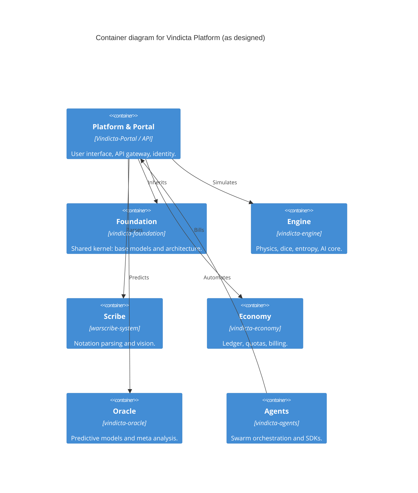

# Vindicta Platform

> **Status:** active, pre-1.0. A personal project by [Brandon Fox](https://github.com/brandon-fox). The core domains were specified and partly implemented in 2025–2026. No code changed between March and November 2026, when work resumed with the dice core (spec 002), built first under [Axiom-Driven Engineering](https://github.com/First-ADE). The repositories are public as a worked example of deterministic, auditable game mechanics designed before code.

Vindicta is a platform for provably fair competitive tabletop wargaming: dice you can audit, a ledger that cannot be silently edited, a notation for recording battles, and models that predict outcomes from that notation. What survives is the design: 47 numbered specifications, the domain split below, and the parts of the engine, ledger and notation that were built.

## Architecture

## Where to read

| Repository | What it holds | State (by last push) |
| --- | --- | --- |
| [`specs`](https://github.com/vindicta-platform/specs) | The specification registry: 47 features, BDD-first, each with `spec.md`, `plan.md` and `tasks.md`. Specs 002–008 (dice core, dice evaluator, dice parser, rules validation, battle transcript engine, entropy buffer) are the ones that matter for the correctness argument. | March 2026, complete as a design |
| [`vindicta-foundation`](https://github.com/vindicta-platform/vindicta-foundation) | Base models, shared kernel, constitutional documentation. | November 2026, maintained as reference |
| [`vindicta-engine`](https://github.com/vindicta-platform/vindicta-engine) | Dice rolling, physics and the AI core; the entropy buffer and evaluator live here. | March 2026, partial implementation |
| `.github` (this repository) | Org profile, contributing guide, CI templates. | Maintained |
| Everything else under this org | Economy, oracle, agents, notation system, portal, orchestrator. | Archived in November 2026; readable, not maintained |

The correctness ideas (a seeded, buffered entropy source whose draws can be replayed; an append-only ledger with hash chaining; a notation that makes a battle reproducible) are written up as a case study on [brandonfox.dev](https://brandonfox.dev) once that page is live.

## Contributing

This is a single-maintainer project, so issues and pull requests are welcome but reviewed slowly. If you want to build on the dice or ledger designs, fork freely; they are MIT licensed. Sign commits with the Developer Certificate of Origin (`git commit -s`); see [`CONTRIBUTING.md`](https://github.com/vindicta-platform/.github/blob/main/CONTRIBUTING.md).

---

All work here is personal and independent of any employer. Views, writing and code are my own. MIT licensed, copyright Brandon Fox.
